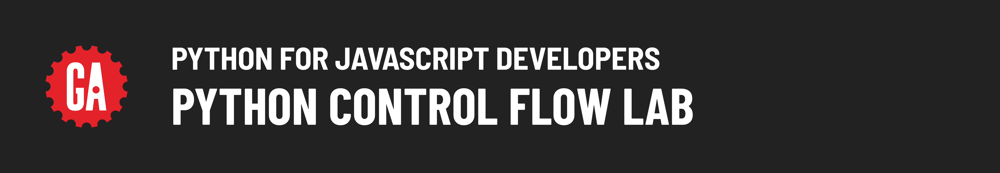

# 

## About

Welcome to the Python Control Flow Lab! In this lab, you'll practice implementing control flow in Python, which includes making decisions with conditional statements, repeating actions with loops, and managing user input.

## Content

- [Setup](../setup/README.md)
- [Exercise](../exercise/README.md)

## Level Up

🚀 [Level Up](../level-up/README.md)
